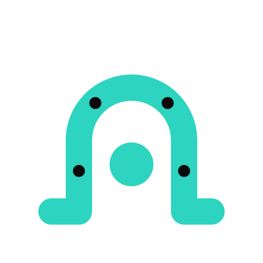
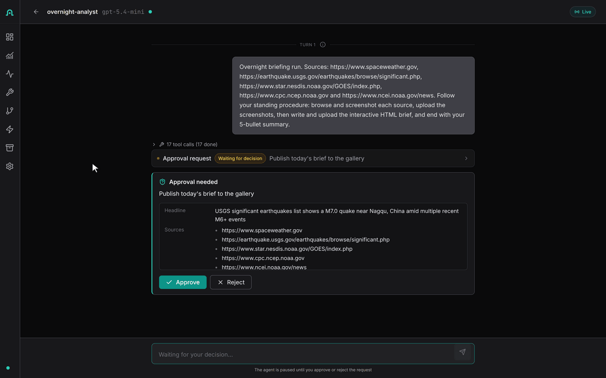
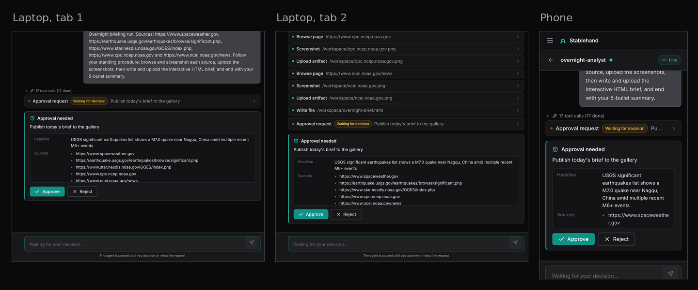
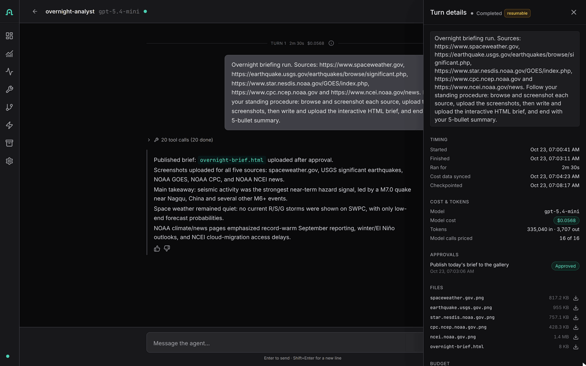
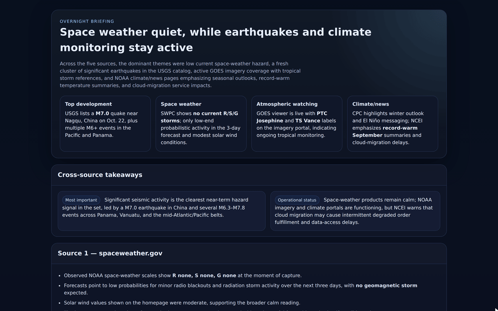

<p align="center">
  
</p>

<h1 align="center">Stablehand</h1>

<p align="center">
  Run agents on a schedule on your own servers. They ask before risky actions, stop at a spend cap, and leave a receipt and a finished file.
</p>

<p align="center">
  <a href="LICENSE"></a>
  <a href="https://github.com/iofold/stablehand/actions/workflows/ci.yml"></a>
</p>

<!--
  HERO MEDIA SLOT
  A 15-20 s looping GIF, 960 px wide, under 10 MB. Upload it as a github.com/user-attachments
  asset instead of committing it, then put the asset URL on its own line here.
  Shot list, split screen with the terminal on the left and the UI on the right, clock and $ counter visible:
    1. The Overnight Analyst schedule fires; the agent browses and screenshots its sources.
    2. An approval card appears; it is approved from a phone while two desktop tabs update.
    3. The finished brief lands in the gallery.
    4. The receipt: model, tokens, cost, approvals, output file.
  Keep a static PNG of frame 3 as the fallback. The 60-90 s captioned cut goes to X, YouTube and the Show HN text.
-->

Stablehand is for agents that run unattended. You describe an agent in YAML, give it a schedule or an event to react to, and it runs in its own Docker container on your machine. Tool calls you mark as risky wait for a person to approve them, from any open browser tab or a phone. Budgets per agent and per tag stop spending at the limit you set, and a per-run cap stops a looping agent in the middle of its run. Every turn records the model, tokens, cost and approvals next to the files the agent produced.

Each agent picks its own loop: LangGraph, the Claude Agent SDK or Pi. MIT licensed.

## Quickstart

You need Docker with Compose and an OpenAI API key.

```bash
curl -fsSL https://raw.githubusercontent.com/iofold/stablehand/master/install.sh | sh
```

The installer clones the repo into `./stablehand`, writes `.env` with generated secrets and starts the stack with the LiteLLM model gateway and the artifact gallery. It pulls prebuilt images from `ghcr.io/iofold`, the ones built from your commit when they exist and `latest` otherwise, and builds any it cannot pull. Then it seeds the [Overnight Analyst](packages/examples/overnight-analyst), which reads web pages and writes a one-page brief, and runs it once. It asks for your OpenAI key unless `OPENAI_API_KEY` is set.

At the end it prints the UI address, your API token and the first run's receipt: model, tokens and cost. The brief is under Artifacts in the UI and in the gallery at http://localhost:8090. Running the installer again keeps your `.env`, starts no new run and spends nothing. Its settings are listed at the top of [install.sh](install.sh); read it before you pipe it to a shell.

To have a coding agent do the install and explain each step, paste the prompt in [docs/install-with-an-agent.md](docs/install-with-an-agent.md) into it.

### Install by hand

#### 1. Clone and configure

`.env.example` already lists the gateway and gallery overlays in `COMPOSE_FILE` and has a blank line for every secret; the `sed` call fills them, so no key appears twice. The gateway prices each model call and stops a run at its spend cap. The last line lets sandboxes read public web pages (GET and HEAD only), which the analyst needs; by default they reach only package registries, GitHub and model APIs.

```bash
git clone https://github.com/iofold/stablehand.git
cd stablehand
cp .env.example .env

export OPENAI_API_KEY=sk-...   # your key
gateway_key=sk-$(openssl rand -hex 24)
sed -i.bak \
  -e "s|^OPENAI_API_KEY=.*|OPENAI_API_KEY=${OPENAI_API_KEY}|" \
  -e "s|^SECRET_MASTER_KEY=.*|SECRET_MASTER_KEY=$(openssl rand -hex 32)|" \
  -e "s|^STABLEHAND_API_TOKEN=.*|STABLEHAND_API_TOKEN=$(openssl rand -hex 32)|" \
  -e "s|^LITELLM_MASTER_KEY=.*|LITELLM_MASTER_KEY=${gateway_key}|" \
  -e "s|^STABLEHAND_MODEL_GATEWAY_METERING_KEY=.*|STABLEHAND_MODEL_GATEWAY_METERING_KEY=${gateway_key}|" \
  -e "s|^STABLEHAND_MODEL_GATEWAY_ADMIN_KEY=.*|STABLEHAND_MODEL_GATEWAY_ADMIN_KEY=${gateway_key}|" \
  -e "s|^STABLEHAND_MODEL_GATEWAY_RUNTIME_KEY=.*|STABLEHAND_MODEL_GATEWAY_RUNTIME_KEY=sk-$(openssl rand -hex 24)|" \
  -e "s|^LITELLM_SALT_KEY=.*|LITELLM_SALT_KEY=$(openssl rand -hex 32)|" \
  -e "s|^LITELLM_DATABASE_PASSWORD=.*|LITELLM_DATABASE_PASSWORD=$(openssl rand -hex 24)|" \
  -e "s|^GALLERY_WEBHOOK_SECRET=.*|GALLERY_WEBHOOK_SECRET=$(openssl rand -hex 24)|" \
  -e 's|^STABLEHAND_EGRESS_EXTRA_ALLOW=.*|STABLEHAND_EGRESS_EXTRA_ALLOW="GET *;HEAD *"|' \
  .env && rm .env.bak
```

#### 2. Start the stack

The pull fetches the prebuilt images. `up` builds any image it could not pull, which takes several minutes the first time; `docker compose up --build -d` builds all of them from your checkout instead.

```bash
docker compose pull --ignore-pull-failures
docker compose up -d
```

#### 3. Seed the Overnight Analyst and run it once

The seed creates the agent, a daily 07:00 UTC schedule, the trigger that turns each fire into a run, and a scoped key for the gallery. It prints that key once, as a `GALLERY_API_KEY=...` line: add the line to `.env` before the next command.

```bash
docker compose exec -e API_URL=http://localhost:3001 \
  -w /app/packages/examples/overnight-analyst \
  orchestrator node --experimental-strip-types seed.ts
```

Then start the gallery with its key and fire one run. `run-once.ts` waits for the run to finish and prints its receipt.

```bash
docker compose up -d gallery
docker compose exec -e API_URL=http://localhost:3001 -e GALLERY_URL=http://gallery:8090 \
  -w /app/packages/examples/overnight-analyst \
  orchestrator node --experimental-strip-types run-once.ts
grep '^STABLEHAND_API_TOKEN=' .env
```

Open http://localhost:3200, paste the token, and open Overnight Analyst to see the run, its receipt and its files. Pass `-e ANALYST_TZ=<IANA zone>` to the seed for a schedule in your own timezone.

<!--
  SCREENSHOT STRIP SLOT
  Four 1440 px PNGs from a clean demo stack (no test agents, no client names), as a 2x2 table:
    approval-card.png   approval card under an agent-drawn chart, human tool names, Approve / Reject
    synced-tabs.png     three browser tabs on the same run, mid-stream, showing identical output
    turn-inspector.png  turn details with model, tokens, cost, duration, budget and approvals
    finished-brief.png  the Overnight Analyst brief as published to the gallery
  Markup to uncomment once the files exist:
  <table>
    <tr>
      <td></td>
      <td></td>
    </tr>
    <tr>
      <td></td>
      <td></td>
    </tr>
  </table>
-->

## Built with Stablehand

| Example | What it does | Where |
|---|---|---|
| Overnight Analyst | Opens your sources in a sandboxed browser every morning, screenshots each one, writes a one-page HTML brief and publishes it to a gallery page. We have run it daily since August 2026. | [packages/examples/overnight-analyst](packages/examples/overnight-analyst) and [extensions/artifact-gallery](extensions/artifact-gallery) |
| Content factory | Each week reads what is working in your niche (Apify) and what came up in your meetings (Granola), drafts a LinkedIn post, an X thread and a blog outline in your voice, and waits for you to approve, edit or reject each one from your phone. Six agents chained by events under one campaign budget. | [packages/examples/content-factory](packages/examples/content-factory) |
| Inbox agent | Gives each incoming email its own sandboxed run, pulls out the fields and shows where in the email each one came from, and drafts a reply that a person approves before it is sent. When the sender answers, the same thread picks up again. | Rebuilding on synthetic email |
| Folder review | Takes a folder of documents, reads every file and returns findings that cite the document and page they came from. Follow-up questions run in the same thread. | Rebuilding on synthetic documents |
| Experiment loop | Runs a benchmark task, reads the graded result, keeps or discards the change and queues the next run, all inside one campaign budget. | Rebuilding on [extensions/gdpval-bench](extensions/gdpval-bench) |
| Chart chat | Answers questions with charts and tables drawn in the reply: bar, line, funnel, sankey, metric cards and 10 more. | The chart catalog ships today; try it in [packages/examples/react-embed-chat](packages/examples/react-embed-chat) |

The inbox agent, folder review and experiment loop started as client and research projects. The public versions run on synthetic data or public benchmarks.

## How it works

An orchestrator (Node.js, Fastify, PostgreSQL) holds everything that has to outlive a run: agents, schedules, triggers, approvals, budgets and the event log. Each agent session runs in its own Docker container, where a small daemon drives the agent loop and talks to the orchestrator over gRPC. The loop runs inside the sandbox; approvals, budgets and schedules stay outside it, where the agent cannot edit them. The container's only route to the internet is an egress proxy that allows listed hosts and nothing else.

Every event the agent produces is written to PostgreSQL before any browser sees it. A reload, a second tab or a phone replays from the same log and then follows it live. Approvals are database rows, so a pending approval survives an orchestrator restart. So does a running turn: the sandbox keeps working while the orchestrator is down, and the restarted process picks the turn back up and replays what it missed. Schedules fire events, triggers turn events into background runs, and files the agent publishes go to S3-compatible storage with a signed webhook to anything that subscribes. A LiteLLM gateway, on in the default install, prices every model call, and the budgets count against those prices.

Clients receive runs as [AG-UI](https://docs.ag-ui.com) events, the open streaming protocol for agent front ends, so AG-UI renderers can display them. Agents draw charts and tables with a built-in render tool that emits [A2UI](https://a2ui.org) blocks, Google's open format for agent-drawn UI. The full design is in [docs/architecture.md](docs/architecture.md).

## How it compares

| | Where it runs | Asks before risky steps | Spend cap | Record of each run | Agent loop |
|---|---|---|---|---|---|
| Stablehand | Your servers, via Docker Compose (MIT) | Approval cards on the tools you mark; pending approvals survive a restart | Budgets per agent and per tag | Model, tokens, cost, approvals and output files per turn | LangGraph, Claude Agent SDK or Pi, chosen per agent |
| Claude Managed Agents | Anthropic's cloud; sandboxes can run in your network | Permission policies; `always_ask` pauses the session | Monthly workspace limit in the Claude Console; no per-run cap documented | Session tracing in the Claude Console | Anthropic's harness, Claude models |
| OpenAI Agents SDK | Your code and servers (it is a library) | `needsApproval` pauses the run | Turn limit (`maxTurns`); no cost cap | Traces in the OpenAI dashboard | The SDK's own loop |
| LangSmith Deployment (formerly LangGraph Platform) | LangChain's cloud; self-hosting needs an Enterprise plan | `interrupt()` pauses a graph for review | No per-run cap documented | Traces in LangSmith | LangGraph graphs |
| Docker and cron | Your servers | Build it yourself | Provider account limits | Your own logs | Anything you write |

Checked against each product's public documentation on 2026-10-22. Corrections are welcome as issues.

## What's next

Each of these ships as an extension, and each has a thread asking what you would use it for.

- Sandbox-free agents: agents that only call tools or answer questions run without a container, under the same approvals, budgets and receipts. [Discuss](https://github.com/iofold/stablehand/discussions/1)
- Confidence-gated approvals: a decision model, called through the gateway's `/v1/decisions` route, scores each risky step; confident steps go ahead and the rest wait for a person. [Discuss](https://github.com/iofold/stablehand/discussions/2)
- Harbor and RL-environment campaigns: scheduled Harbor runs with a campaign budget, a review queue and a receipt for every trial. [Discuss](https://github.com/iofold/stablehand/discussions/3)

## Current boundaries

- Docker Compose is the supported install. Sandboxes are Docker containers, not microVMs.
- Sandboxes receive the model-provider keys and S3 credentials they use. A credential broker in the egress proxy is planned; until then, see [SECURITY.md](SECURITY.md) for the threat model.
- Per-run spend caps need the LiteLLM gateway. The gateway checks the cap before each model call, so the call that crosses the cap finishes and the run stops before the next one. Agents that call a provider directly are only checked when a turn starts.
- If the orchestrator dies, a running turn keeps going in its sandbox for 120 seconds (`STABLEHAND_TURN_ORPHAN_GRACE_MS`) and the restarted orchestrator picks it up. A tool that runs inside the orchestrator and was cut off by the crash runs again, so give tools with side effects an idempotency key. If the sandbox died too, the turn ends in an error.
- Approval gates cover every tool you mark (local, HTTP and MCP) and the built-in `request-approval` tool. The Claude Agent SDK's own Bash, Write and Edit tools run without asking; the container is the boundary.
- The default install sends model calls through the LiteLLM gateway, so runs show their full cost. Agents whose manifest sets `apiKeyRef` call the provider directly and may show as unpriced, and Claude Agent SDK usage is under-counted.
- Agents reach remote MCP servers over Streamable HTTP, with bearer, header or OAuth sign-in handled by the orchestrator ([docs/mcp-servers.md](docs/mcp-servers.md)). Local stdio servers, per-user sign-in and Composio are not supported yet.
- There is no built-in knowledge or RAG search.
- The npm packages (`stablehand`, `create-stablehand`, `@stablehand/*`) are ready to publish but not on npm yet, so `npx create-stablehand` does not work today.

## Configuration

Settings live in `.env` (start from [.env.example](.env.example)). The full list is in [docs/environment-variables.md](docs/environment-variables.md).

| Variable | Purpose |
|---|---|
| `OPENAI_API_KEY`, `ANTHROPIC_API_KEY`, `GOOGLE_API_KEY` | Provider keys. Agents reference them as `$secret:NAME` in their manifests. |
| `SECRET_MASTER_KEY` | Encrypts per-agent secrets (AES-256-GCM). Required. |
| `STABLEHAND_API_TOKEN` | Operator master token for the API and UI. Required. Create scoped `cmk_` keys for extensions under Settings, Access keys. |
| `STABLEHAND_EGRESS_EXTRA_ALLOW` | Extra egress rules for sandboxes, `;`-separated, appended to [packages/egress-proxy/rules.default.txt](packages/egress-proxy/rules.default.txt). |
| `COMPOSE_FILE` | The compose files that make up the stack. `.env.example` lists the base file, the model gateway and the gallery. |
| `STABLEHAND_IMAGE_TAG` | Tag of the `ghcr.io/iofold/stablehand-*` images. `latest` follows master; set a release such as `0.1.0` or `sha-<commit>` to pin one. |
| `LITELLM_MASTER_KEY`, `STABLEHAND_MODEL_GATEWAY_*` | Model gateway credentials; [deploy/compose/model-gateway](deploy/compose/model-gateway/README.md) explains each. |

Runtime knobs such as timeouts, container limits and queue sizes are stored in the database and edited in the UI under Settings.

The stack is `docker-compose.yml` plus overlays, listed in `COMPOSE_FILE`:

- The LiteLLM model gateway, on by default. It prices every model call and enforces per-run caps: [deploy/compose/model-gateway](deploy/compose/model-gateway/README.md).
- The artifact gallery, on by default: [extensions/artifact-gallery](extensions/artifact-gallery).
- Your own domain behind an existing Traefik: [deploy/compose/traefik](deploy/compose/traefik/docker-compose.yml). Append it to `COMPOSE_FILE` and set `STABLEHAND_DOMAIN`.

Remove an overlay from `COMPOSE_FILE` to run without it. `COMPOSE_FILE=docker-compose.yml` is the base stack, with model calls going straight to the provider.

| Service | Address |
|---|---|
| UI | http://localhost:3200 |
| API | http://localhost:3002 |
| PostgreSQL | localhost:5433 |
| Artifact gallery | http://localhost:8090 |
| LiteLLM gateway | http://127.0.0.1:4400, loopback only |
| Sandbox egress proxy | `egress:8080`, on the internal agents network only |
| pgAdmin (`--profile debug`) | http://localhost:5050 |

Day-to-day commands: `docker compose logs -f`, `docker compose down`, and `docker compose down -v` to also delete the data volumes.

## Packages

| Path | Contents |
|---|---|
| [packages/stablehand](packages/stablehand) | The orchestrator: API, schedules, triggers, approvals, budgets, sandbox sessions |
| [packages/sandbox-daemon](packages/sandbox-daemon) | Runs inside each sandbox: the LangGraph, Claude Agent SDK and Pi adapters and the tool proxy |
| [packages/egress-proxy](packages/egress-proxy) | The mitmproxy allowlist that is each sandbox's only route out |
| [packages/ui](packages/ui) | React dashboard |
| [packages/client](packages/client), [packages/react](packages/react) | Browser client and React components for embedding the chat in your own app |
| [packages/contracts](packages/contracts), [packages/shared](packages/shared), [packages/proto](packages/proto) | API schemas, event types and the gRPC definitions |
| [packages/manifest](packages/manifest) | The YAML agent manifest parser |
| [packages/create-stablehand](packages/create-stablehand) | Project scaffold with `assistant` and `overnight-analyst` templates on the prebuilt images (waits on the npm publish) |
| [packages/examples](packages/examples) | overnight-analyst, kitchen-sink (one agent per loop, 11 shared tools), react-embed-chat, artifact-console |
| [extensions](extensions) | artifact-gallery and gdpval-bench, both running beside Stablehand on scoped keys |

## Documentation

- Start here: [Architecture](docs/architecture.md), [Codebase map](docs/codebase-map.md), [One-pager](docs/stablehand-one-pager.md), [API reference](docs/api-reference.md), [Environment variables](docs/environment-variables.md).
- Building on it: [Extending Stablehand](EXTENDING.md), [Scoped API keys](docs/scoped-api-keys.md), [Harness comparison](docs/harness-comparison.md), [Custom model providers](docs/custom-providers.md), [Writing tool providers](docs/writing-tool-providers.md), [Writing skills](docs/writing-skills.md), [Programmatic tool calling](docs/programmatic-tool-calling.md).
- Front ends: [AG-UI compatibility](docs/ag-ui-compat.md), [React chat integration](docs/integrate-chat-ui.md), [Embedding in other stacks](docs/embedding-in-foreign-stacks.md), [Approval flow](docs/HITL_APPROVAL_FLOW.md).
- Operations: [Checkpoint and resume](docs/checkpoint-resume.md), [Container lifecycle](docs/container-lifecycle.md), [Observability](docs/observability.md), [LangSmith tracing](docs/langsmith-tracing.md), [Debugging harnesses](docs/debugging-harnesses.md), [Event pipeline mapping](docs/event-pipeline-mapping.md).

## Contributing

Read [CONTRIBUTING.md](CONTRIBUTING.md) for the development loop and [AGENTS.md](AGENTS.md) for the codebase conventions. `pnpm test` runs the Vitest suites; browser certification is described in [docs/e2e-testing-journey.md](docs/e2e-testing-journey.md). Report security issues privately as described in [SECURITY.md](SECURITY.md). Participation follows the [Code of Conduct](CODE_OF_CONDUCT.md).

## License

[MIT](LICENSE)
