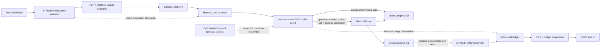

# LiteLLM-backed cost visibility with harness-native model access

Status: accepted implementation specification, revised 2026-07-23.
Implementation is pending.

This is the canonical specification for model access, usage metering, cost
visibility, and budget enforcement. It supersedes the Phase C price-catalog
direction in
`docs/plans/proposals/2026-07-15-tag-based-budget-policies.md` and is the
integration boundary for the deferred intra-turn work in
`docs/plans/proposals/2026-07-18-intra-turn-budget-enforcement.md`.

## Decision

STABLEHAND will support a self-hosted LiteLLM Proxy as an optional,
deployment-scoped model gateway for governed and evaluation workloads.
Harnesses retain their native model configuration and SDK/API semantics;
LiteLLM credentials remain deployment infrastructure rather than STABLEHAND
policy, agent, or run data.

- LiteLLM owns upstream provider credentials, stable model aliases, routing,
  retries/fallbacks, call-level token and cost calculation, and the
  authoritative operational spend log for calls that traverse it.
- Deployment configuration owns the LiteLLM endpoint, one runtime credential
  per environment, and one metering/admin credential per environment.
- Each harness owns its model selection, native protocol/client, generation
  controls, subagent model overrides, and any direct provider connection
  fields already defined by that harness.
- STABLEHAND does not add a public model-route resource, a universal model-client
  abstraction, or a mandatory `llm` block to `harnessConfig`.
- Direct-only deployments and explicitly direct/custom harness connections
  remain first-class. A disabled gateway creates no startup, health, network,
  or credential dependency.
- STABLEHAND owns budget policy documents, selector and bucket semantics, turn
  admission, model-call-to-turn attribution, typed product errors, durable read
  projections, and UI state.
- No STABLEHAND policy, bucket, agent, conversation, turn, or evaluation row
  references a LiteLLM key.
- STABLEHAND does not select or create a LiteLLM key per run.
- STABLEHAND does not synchronize policies into LiteLLM tag budgets, users, teams,
  or virtual keys.
- STABLEHAND does not build a model-pricing catalog or normalize model names
  across harnesses.
- STABLEHAND does not query or share LiteLLM database tables. It integrates
  through the gateway protocol and documented spend APIs.
- Initial cost-policy enforcement remains at the turn-admission boundary.
  An optional environment-level LiteLLM key budget is an operations-owned
  runaway ceiling, not a projection of STABLEHAND policies.
- A small local model-call ledger and turn/budget read projection provide
  idempotency, attribution, product availability, and honest coverage state.
- The first implementation uses spend-log reconciliation only. A callback is
  a later latency optimization, not part of the correctness path.
- The sandbox daemon exposes a small harness-side observation/enforcement seam
  so future per-call allowances and mid-turn stops can be added without
  changing the credential, harness-configuration, or policy contracts.
- OpenMeter and Portkey are not added in this phase. OpenMeter becomes relevant
  if STABLEHAND later needs customer billing, credits, invoices, or non-LLM usage
  metering. Portkey would duplicate the selected gateway role.

This keeps LiteLLM useful for what it already centralizes while avoiding both
a distributed policy-to-key synchronization system and a leaky universal
model abstraction.

## Why the current design is insufficient

The current runtime stores one aggregate usage object at turn completion:

- LangGraph replaces earlier model-call usage with the last observed call.
- PI can turn an unknown model's zero-valued local rate card into a false
  `$0.00`.
- Claude Agents is the only shipped adapter that currently retains a positive
  monetary cost.
- `NULL`, real zero, and partial reporting are collapsed in budget aggregates
  and several UI projections.
- Budget contracts are duplicated outside `@stablehand/contracts`.
- A crossed `block` can be bypassed when a higher-threshold `warn` is selected
  first.
- Admission-only enforcement cannot stop the next call in a long tool loop.

A local price catalog would fix only some of this and duplicate model aliases,
provider pricing, cache rates, and routing metadata already maintained by a
gateway. Coupling LiteLLM keys to STABLEHAND policies would replace that catalog
with a more difficult distributed synchronization problem.

## Ownership boundary

| Concern | Canonical owner | STABLEHAND responsibility |
|---|---|---|
| Gateway upstream provider API keys | LiteLLM deployment | None |
| Direct provider API keys | Existing STABLEHAND secret provider or deployment environment | Resolve only for explicitly direct/native harness access |
| LiteLLM runtime credential | Docker/Kubernetes deployment secret | Make it available to sandbox model clients without persisting it |
| LiteLLM metering/admin credential | Docker/Kubernetes deployment secret | Use only inside the orchestrator-side LiteLLM adapter |
| Model selection and generation controls | Harness schema and native SDK | Preserve harness-native semantics; do not translate into a universal route contract |
| Gateway aliases and upstream routing | LiteLLM config | Send the model string selected by the harness and observe the resolved deployment |
| Direct endpoint/provider selection | Harness schema and adapter | Preserve existing explicit `apiKeyRef`/`baseUrl` behavior |
| Call token/cost calculation | LiteLLM | Validate and ingest the result |
| Direct-call usage/cost | Native harness SDK when available | Normalize an honest observation; otherwise mark unavailable |
| Gateway call spend history | LiteLLM | Reconcile it into a local read projection |
| Call-to-turn identity | STABLEHAND | Attach and persist an opaque correlation identity |
| Budget policy | STABLEHAND | Validate, persist, evaluate, and expose |
| Selector and `groupBy` semantics | STABLEHAND | Resolve a turn to every matching policy bucket |
| Precise cost-policy block | STABLEHAND | Enforce at turn admission from local projections |
| Environment runaway ceiling | LiteLLM deployment, optional | Map a gateway rejection to a typed operational error |
| Token and turn limits | STABLEHAND | Admission enforcement; optional mid-turn allowance later |
| Product errors and UI | STABLEHAND | Expose canonical policy and coverage state |
| Provider invoice truth | Provider admin APIs, later | Explicitly out of scope |

## Runtime architecture



Every gateway-enabled model call traverses LiteLLM, but no model call
synchronously traverses the STABLEHAND API after sandbox delivery. Policy
evaluation and spend ingestion remain local/asynchronous respectively.

There are three independent concerns:

1. **Harness execution:** the selected harness and its native configuration
   choose the model, client protocol, subagent overrides, and generation
   controls.
2. **Optional gateway access:** deployment endpoint and credential → the
   harness's native client → LiteLLM alias/upstream routing.
3. **Policy/accounting:** turn tags → STABLEHAND policies; call correlation →
   LiteLLM spend log → STABLEHAND ledger.

The credential is not an attribution key, and the model name is not a policy
identity.

## Deployment-scoped gateway credentials

When enabled, the initial deployment has one `default` LiteLLM profile:

- protocol-native internal endpoints required by the certified harnesses;
- one runtime virtual key or equivalent gateway credential;
- one metering/admin credential restricted to the spend endpoints when the
  selected LiteLLM edition permits that separation.

Both credentials are deployment secrets:

- They are configured in Compose/Kubernetes, not created by STABLEHAND APIs.
- They do not appear in agent manifests, budget documents, database rows,
  events, callback payloads, or browser responses.
- The runtime credential is made available to model clients through sandbox
  bootstrap/runtime secret injection.
- Gateway access is internal runtime context, separate from
  `harnessConfigJson`. It does not rewrite the stored agent manifest.
- It is never accepted from caller-supplied `sandboxSecrets`; reserved gateway
  secret names cannot be overridden.
- Gateway availability is resolved before sandbox credentials are assembled.
  The gateway endpoint and runtime credential use a dedicated internal
  `ModelGatewayAccess` value or a reserved environment namespace; they are
  never resolved from an agent secret reference.
- Existing provider secrets remain available only to native/direct clients
  that require them. They cannot shadow gateway access values, and a
  gateway-only certification case proves that no upstream provider credential
  enters that sandbox.
- It is never persisted in a checkpoint. STABLEHAND does not currently refresh
  stable secrets inside a warm sandbox, so a restored or recreated container
  receives current deployment secrets while an incompatible warm container is
  drained and replaced.
- The metering/admin credential remains orchestrator-side and never enters a
  sandbox.
- Key rotation is an environment operation. A non-secret gateway credential
  revision is part of sandbox compatibility, so rotation drains and recreates
  affected warm sessions without migrating agents, policies, conversations,
  or turns. Agent-secret mutations similarly invalidate affected sessions;
  secret values are never fingerprinted or persisted.

The runtime credential is necessarily readable by the sandbox daemon/harness
process and therefore has a broader blast radius than a provider key scoped to
one agent. The simple shared environment key is retained deliberately, but it
must be least-privilege: model/alias and inference-route access only, no spend
or administrative endpoints, an operations-owned rate/budget ceiling,
internal-only gateway reachability, orphan-call alerts, and tested rotation
with session drain. STABLEHAND does not claim that the credential is inaccessible
to code executing inside the sandbox.

Normal runs, background runs, evaluations, retries, subagents, queued turns,
and resumed turns that use the deployment gateway all use the environment
credential. No component chooses among keys for a particular run.

Connection resolution is explicit and compatibility-preserving:

- Each parent model, subagent, or other native client configuration branch
  resolves independently at client construction time.
- An explicit branch-local `apiKeyRef` or `baseUrl` retains its direct/custom
  meaning and is never silently overwritten by the gateway.
- Otherwise, a gateway-enabled deployment supplies its protocol-native
  endpoint and runtime credential only when that exact harness/client/protocol
  row passed certification.
- When the gateway is disabled or the native protocol row is not certified,
  the branch retains its current provider/environment behavior.
- A deployment may later add a gateway-only operational mode, but it is not
  part of the initial product contract.
- The complete set of effective branch connection modes and the non-secret
  deployment credential revision are part of sandbox-session compatibility. A
  warm session or checkpoint opened with different connection behavior must
  not be reused.

This permits direct and gateway-enabled agents in one installation without a
new per-agent route object. Moving an existing explicit-direct agent onto the
gateway is an intentional agent edit that removes its direct override; it is
not an automatic stored-agent migration. Enabling the deployment gateway does
not make those explicitly direct calls visible in LiteLLM spend data; they
retain native harness cost coverage, which may be partial or unpriced.

If the deployment later provides network identity, mTLS, or a trusted
authentication proxy, it may replace the runtime key without changing any
STABLEHAND contract. An unauthenticated internal LiteLLM endpoint is forbidden
until real network isolation is present.

An operations-owned `max_budget` on the environment credential may provide a
coarse emergency ceiling. Exhausting it affects the whole credential scope and
must surface as `model_gateway_budget_exceeded`; it must never be misreported
as a particular STABLEHAND policy or bucket.

## Preserve harness-owned model configuration

The shipped public envelope remains:

```yaml
spec:
  harness: claude-agents
  harnessConfig:
    model: claude-sonnet-4-6
    apiKeyRef: "$secret:ANTHROPIC_API_KEY"
```

`harnessConfig` is required as an object, but the selected harness owns and
strictly validates its contents. The built-in harnesses currently use:

| Harness | Native model configuration |
|---|---|
| LangGraph | Required parent `model`; provider/client selection; optional generation controls, endpoint/key overrides, middleware, and per-subagent model/provider overrides |
| Claude Agents | Required parent Claude `model`; optional Anthropic endpoint/key override and `maxTurns`; per-subagent Claude model overrides |
| PI | Required `model`; provider/client selection; optional endpoint/key override and extensions |

Rules:

- There is no STABLEHAND route resource, route ID, model catalog, or mandatory
  `llm` block.
- One-model, multi-model, subagent, and dynamic model-selection semantics
  remain native to each harness.
- Claude Agents continues to issue Anthropic Messages calls and to pass native
  parent/subagent model strings. It is not forced through an OpenAI-shaped
  client.
- LangGraph and PI retain their native client factories. The adapters may use
  LiteLLM's protocol-compatible endpoint when gateway access is active.
- A model string is a direct provider model ID in direct mode and may be a
  LiteLLM alias in gateway mode. Operators can define gateway aliases equal to
  existing model strings to avoid agent edits.
- Upstream provider, resolved model, deployment, and metering source are call
  observations, not agent-authored policy fields.
- A custom harness may define an empty or completely different
  `harnessConfig`; cost control does not require model fields in every harness.
- Raw/native SDK calls are valid. Calls traversing LiteLLM are reconciled from
  its spend log; direct calls use exact harness-reported usage when available.
  Calls observed by neither source are unavailable, never free.

Commonality belongs at the usage and enforcement boundaries, not in a
universal model-client configuration. Existing agents and manifests therefore
require no model-configuration migration for this project.

## Canonical budget contract

Budget documents move to strict schemas in `packages/contracts/src/budgets.ts`.
HTTP routes, repository boundaries, SDK/client methods, and UI code consume
those schemas directly.

```json
{
  "selector": { "bu": "finance" },
  "groupBy": "user",
  "window": "rolling-24h",
  "limits": {
    "totalTokens": 200000,
    "costUsd": 5.0,
    "turns": 500
  },
  "actions": [
    { "threshold": 0.8, "action": "warn" },
    { "threshold": 1.0, "action": "block" }
  ]
}
```

### Window semantics

LiteLLM does not define STABLEHAND policy windows. Preserve the existing
semantically explicit windows:

| Value | Exact semantics |
|---|---|
| `rolling-1h` | The preceding 60 minutes |
| `rolling-24h` | The preceding 24 hours |
| `rolling-7d` | The preceding 7 × 24 hours |
| `rolling-30d` | The preceding 30 × 24 hours |
| `month-to-date` | UTC first-of-month 00:00 through now |

No window is changed to fit a LiteLLM key/tag duration. A future mid-turn
allowance is calculated from the same STABLEHAND window semantics.

All turn, token, and eventual cost usage is attributed to the owning
`turn.startedAt`, preserving the shipped repository semantics. Model-call
start/end/ingest timestamps are operational metadata and do not move spend
between policy windows. Tests cover cost reconciled after its turn crosses a
rolling or month-to-date boundary.

### Action rules

- `totalTokens` and `turns` must be positive integers.
- `costUsd` must be a finite positive number.
- At most one `warn` and one `block` action are accepted initially.
- Actions are normalized by threshold; when both exist, `warn < block`.
- A crossed block always wins independently of display/action order.
- Every matched policy bucket receives the turn's eventual usage.
- Admission is rejected if any matched bucket has crossed its block threshold.
- Evaluation errors remain fail-open initially and emit explicit degraded
  health; they never turn an unknown cost into zero.

The future mid-turn contract may add a distinct `cancel` action, but it is not
part of the first gateway release.

## Call correlation without routes or policy tags

Cost attribution must not depend on a key, policy projection, raw business
tag, or Enterprise-only spend metadata.

For gateway-enabled calls, each harness adapter must provide a stable
relationship among:

- STABLEHAND `turnId`;
- a unique logical call ID for each parent or nested client invocation;
- every gateway transaction ID that LiteLLM records for that invocation.

The selected pinned LiteLLM version determines the exact transport:

1. Prefer an opaque logical call ID that is returned or recorded on every
   spend transaction produced for that invocation.
2. Otherwise attach an opaque turn correlation field and capture LiteLLM's
   generated call ID from the response/stream.
3. If a native client cannot expose either reliably, that harness/protocol row
   fails Phase 0; STABLEHAND does not fall back to route identity, key identity,
   timing guesses, or raw business tags.

Correlation values contain opaque IDs only. They do not include user email,
tenant name, business-unit name, policy name, selector, or bucket value.

For every instrumentable call the adapter records or emits a small internal
`ModelCallObservation` containing the turn ID, a stable call ID where
available, the requested model string when safely observable, usage, and
completion state. It does not expose provider credentials or a universal
model-client interface. Gateway observations join the spend record back to the
turn; direct observations may supply exact harness usage without a gateway.
The turn's persisted tags then attribute the result to all matching STABLEHAND
policy buckets.

Separate harness client invocations receive distinct logical call IDs.
LiteLLM-internal retries and fallbacks retain one logical call ID but have
distinct billable-attempt transaction IDs, so real upstream spend is neither
collapsed nor counted as extra logical model calls. Replayed ingestion of the
same gateway transaction is deduplicated by the ledger.
If an SDK hides call boundaries, the adapter declares `turn_only` capability
and supplies only terminal aggregate usage. The system does not fabricate
per-call completeness.

The sandbox boundary carries a separate internal
`HarnessTurnUsageObservation`, not the public `TurnUsage`. It contains only
what the harness can observe at execution time: call or aggregate identity,
tokens, requested/reported model details, completion state, and optional cost
with provenance. It does not contain reconciliation state, `knownUsd`, or
product coverage. The orchestrator joins those observations with ledger and
LiteLLM data and is the sole component that materializes canonical
`TurnUsage`.

The initial transport is an internal `model_call_observed` event on the
existing daemon-to-orchestrator gRPC stream after each observable completed
call. The orchestrator idempotently upserts it immediately by logical call ID;
it is not forwarded to AG-UI, SSE, webhooks, or the public event contract. This
preserves completed-call usage if a later call is denied, cancelled, or
crashes. A `turn_only` harness instead attaches one deterministic, bounded
aggregate observation to its terminal daemon event. Replay, reconnect, and
duplicate terminal delivery must converge on the same rows. The old proto
`DoneEvent.TokenUsage` is replaced by these internal observation messages in
the lockstep daemon/orchestrator image release.

## Metering and durable usage

The first implementation polls documented unsummarized LiteLLM spend logs.
It does not configure a Generic API callback.

`LiteLlmSpendReconciler`, present only when the gateway is enabled:

- uses the deployment metering/admin credential;
- reads individual transaction records through LiteLLM's HTTP API;
- has at most one database-leased owner per gateway profile; another
  orchestrator replica may take over only after lease expiry;
- keeps a durable watermark and an overlap window;
- validates a narrow adapter-owned ingress schema;
- drops messages, responses, API bases, raw key metadata, and unrecognized
  fields before persistence;
- durably quarantines sanitized invalid or orphan/unattributed transactions
  when a stable gateway transaction ID is available;
- does not advance the page watermark when the pagination envelope or a row
  lacks enough stable identity to quarantine safely;
- merges a matched spend record into the existing logical call row rather than
  adding a second billable observation;
- commits each validated page and its watermark advancement transactionally;
- exposes last-success time, lag, invalid-row count, and orphan count.

Phase 0 must prove pagination, ordering, retention, overlap behavior, completed
stream visibility, and the correlation fields against the exact pinned image.
If the spend API cannot support correct polling, callback ingestion may be
added behind the same ledger idempotency boundary; it is not designed in
advance as a second required path.

Persisting a sanitized quarantine record is part of page success, not a
count-and-drop side effect. If its opaque correlation can identify a turn,
that turn remains visibly pending/degraded until the row is repaired and
replayed. Otherwise it remains an orphan alert. No watermark may make an
unpersisted invalid transaction permanently invisible.

### Model-call ledger

Add `model_call_usage` with the minimum sanitized fields:

- STABLEHAND logical call ID and observation kind (`call` or `turn_aggregate`);
- gateway profile/revision and reconciliation state when applicable;
- turn ID (nullable only for quarantined orphan calls) and success/failure
  status;
- requested model/alias, resolved model/deployment ID, and upstream provider when
  safely available;
- prompt, completion, total, cache-read, cache-create, and reasoning tokens
  when reported, plus token source (`harness` or `litellm`);
- response cost, cost state, and cost source (`litellm`,
  `harness_reported`, `harness_estimate`, or absent);
- start/end/ingest timestamps.

One logical model call has one row, unique on `(turnId, logicalCallId)`.
Immediate harness usage creates or updates that row. Phase 0 must then prove
whether the pinned LiteLLM version emits one aggregate spend transaction or
one transaction per retry/fallback attempt:

- In proven 1:1 mode, the logical row carries the gateway transaction ID and
  reconciled usage/cost, with a unique
  `(gatewayProfile, gatewayTransactionId)` constraint.
- In 1:N mode, add `model_call_attempt_usage`, unique on
  `(gatewayProfile, gatewayTransactionId)`, with resolved model/provider,
  status, tokens, and cost per billable attempt. Attempts roll up into their
  one logical call without incrementing `modelCalls.observed`.

The schema choice is a Phase 0 output, not an assumption. Later LiteLLM
reconciliation attaches transaction identity and fills cost on the logical
row or its attempt children. Every persisted gateway transaction is unique in
both modes. An overlap-polled orphan is attached by updating its existing
transaction row, never by inserting a second copy.
Complete LiteLLM token usage becomes canonical for a gateway call; if the spend
row lacks token fields, the harness values remain canonical and coverage is
degraded. Token discrepancies are measured and retained as operational
diagnostics; the two observations are never summed. A replayed direct
observation uses the same logical call ID. A `turn_only` adapter uses one
deterministic aggregate ID for the turn rather than inventing call
granularity.

A `turn_aggregate` ledger row contributes tokens and aggregate cost but does
not increment `modelCalls.observed` or `modelCalls.costKnown`; those counts
remain zero with `expected: null` because the hidden number of logical calls
is unknown.

In 1:N mode, canonical gateway tokens and cost sum every billable attempt,
including a charged failed attempt before a fallback, while logical
`modelCalls` still counts the client invocation once. Cost is known for that
logical call only after the pinned gateway semantics prove the invocation is
settled and every recorded billable attempt is priced or explicitly free.

Cost state is one of:

- `priced`;
- `explicit_free`;
- `unpriced`.

Missing price or cost-calculation failure is `unpriced`. Positive token usage
plus numeric zero is accepted as free only when the pinned gateway
configuration explicitly marks that alias free. Unknown pricing never becomes
zero.

LiteLLM cost is an operational estimate, not an invoice. Pin the gateway image
and pricing configuration and record a gateway revision on each LiteLLM row.
Pricing changes happen through an intentional gateway release.

The first release deliberately retains finite nonnegative JavaScript numbers
and PostgreSQL `double precision` for USD estimates. Budget comparison uses
the same persisted aggregate value; UI formatting may round for display but
never feeds enforcement. This avoids a decimal-money subsystem for
non-invoice estimates. Before customer billing, credits, invoice
reconciliation, or legally material money movement, migrate the ledger and
public money contract together to fixed-decimal semantics.

### Canonical turn usage

Replace ambiguous optional `costUsd` projections with one canonical contract:

```ts
interface TurnUsage {
  inputTokens: number;
  outputTokens: number;
  totalTokens: number;
  modelCalls: {
    observed: number;
    costKnown: number;
    expected: number | null;
  };
  cost: {
    totalUsd: number | null;
    knownUsd: number;
    coverage: 'pending' | 'complete' | 'partial' | 'unpriced';
  };
}
```

`TurnUsageSchema` lives in `@stablehand/contracts` and is reused by REST, terminal
events, webhooks, the client, and React bindings. Each usage-bearing container
contract has a required `usage: TurnUsage | null` field. `null` means no
trustworthy usage observation exists; omission and fabricated all-zero usage
are not alternate representations. A turn that provably made zero model calls
may report a complete known zero.

Conversation, agent, and budget projections reuse the same token, model-call,
and cost fields and additionally include:

```ts
interface UsageAggregateReporting {
  turns: number;
  usageReportedTurns: number;
}
```

This preserves token-reporting coverage when an aggregate mixes observed and
unobserved turns. The UI never infers completeness from a numeric sum alone.

Semantics:

- `totalUsd: 0` plus `coverage: complete` is a real known zero.
- `totalUsd` is non-null only for `complete`; otherwise it is `null` and is
  never rendered or enforced as free.
- `knownUsd` permits an honest “at least” display for partial coverage.
- Cost provenance is per model-call ledger row. A singular turn-level source
  is invalid because one turn may contain gateway and direct calls.
- `modelCalls.costKnown` counts positive priced and explicitly free logical
  calls. The name means exactly what the field measures.
- `expected` is populated only when an adapter can reliably enumerate model
  calls. It remains `null` for turn-only harnesses.
- Gateway calls use LiteLLM cost and do not add harness-reported cost a second
  time.
- Direct calls may use a finite harness-reported or explicitly identified
  harness-estimated cost with its exact provenance; otherwise they are
  unpriced. A library's unknown-model default zero is never accepted as an
  estimate.
- Token aggregation uses exactly one source per call. Harness tokens may be
  shown immediately, then replaced by the pinned LiteLLM source after
  reconciliation and compared for diagnostics; they are never summed twice.
- Coverage precedence is deterministic:
  1. `pending` if any known gateway call/attempt is not settled; it dominates
     other states.
  2. `complete` only for a verified zero-call turn, when every expected
     logical call has known cost, or when a turn-only harness reports an exact
     aggregate cost.
  3. `partial` when nothing is pending and at least some cost is known but
     another expected, observed, or potentially hidden call is unpriced.
  4. `unpriced` when calls occurred but none has known cost and nothing is
     pending.
- `expected: null` never implies completeness by itself. Only an exact
  turn-aggregate cost may make a `turn_only` observation complete.
- Aggregate coverage is `pending` if any included turn is pending; otherwise
  it is `complete` only when every included turn has non-null complete usage,
  `unpriced` when no cost is known, and `partial` for every other mixture.
  An empty aggregate is a verified complete zero.

Turn finalization cannot wait for asynchronous reconciliation. A turn with
gateway calls therefore persists immediate harness usage with cost coverage
`pending`.
Reconciliation updates the durable aggregate idempotently. Initial clients
refetch/poll canonical REST state; a dedicated late-usage SSE event is deferred
until measured UX latency justifies it.

The original terminal event and webhook remain finish-time facts and may
therefore contain `pending`; append-only history is not rewritten with later
cost. When reconciliation changes known cost, it invokes the same budget
threshold evaluator used at turn completion for every affected policy bucket.
The ledger update, spend delta, and any `budget.threshold` event/outbox record
share a transaction or deterministic source-change id, so retries cannot emit
the same crossing twice. The next admission and every REST status projection
use the updated durable aggregate.

## Initial enforcement behavior

### At turn admission

STABLEHAND:

1. Resolves all matching policy buckets from the turn's tags.
2. Rejects unprovisioned `groupBy` values.
3. Checks token and turn limits from local durable data.
4. Checks known cost from the latest reconciled local projection.
5. Rejects when any matched bucket has crossed its `block` threshold.
6. Admits with explicit degraded coverage when relevant cost is pending,
   partial, or unpriced.

Admission does not call LiteLLM. The first release preserves the existing
fail-open policy on evaluator/storage faults while making degraded protection
visible.

Reconciliation lag means a just-completed call may not affect the next
admission immediately. This is accepted and measured. The environment key
ceiling and harness execution limits contain catastrophic runaway but are not
presented as exact policy enforcement.

### At each model call

Initially:

- gateway-enabled calls use the environment LiteLLM credential and LiteLLM may
  enforce an operations-owned credential budget/rate limit;
- direct calls retain their harness-native authentication path;
- the harness adapter applies its configured execution limits such as
  `maxTurns`, output-token ceilings, deadlines, or recursion limits;
- no STABLEHAND policy lookup or key selection occurs;
- no synchronous call to the orchestrator occurs.

If the environment credential ceiling is crossed, STABLEHAND maps the gateway
error to `model_gateway_budget_exceeded`. It does not name a STABLEHAND policy
and has no effect on direct calls.

## Extensible harness-side mid-turn enforcement

The sandbox daemon will define a narrow internal enforcement seam now so later
mid-turn control does not require reworking credentials, native clients, or
harness configuration.

The conceptual contract is:

```ts
interface HarnessTurnEnforcer {
  beforeModelCall(context: ModelCallAttempt): Promise<ModelCallDecision>;
  afterModelCall(result: ModelCallObservation): Promise<ModelCallDecision>;
  onToolBoundary?(context: ToolBoundary): Promise<ModelCallDecision>;
}

type ModelCallDecision =
  | { action: 'continue' }
  | { action: 'deny_next_call'; reason: TurnEnforcementReason }
  | { action: 'cancel_turn'; reason: TurnEnforcementReason };
```

This is an internal daemon/harness interface, not a public budget API.

Rules:

- The enforcer never receives a LiteLLM key.
- The enforcer does not select a model or resolve a route.
- The enforcer never receives or evaluates a full budget-policy document.
- It has no database dependency and makes no orchestrator network call in the
  initial design.
- Adapters report call boundaries and observed usage through this seam where
  their SDK permits it.
- The initial implementation is a pass-through observer around existing
  harness-native execution limits.
- The common interface records harness capabilities explicitly:
  `before_and_after`, `after_only`, or `turn_only`; active-call cancellation;
  and soft-stop/tool-denial support.
- A harness that cannot expose a pre-call boundary may still observe completed
  usage and deny the next call. The capability must be visible rather than
  implied.
- Usage observed before cancellation must survive in the terminal turn record.
- One call already in flight cannot be unspent.

### Future allowance contract

When mid-turn enforcement is activated, admission may derive a non-secret,
bounded `TurnAllowance` from all matched STABLEHAND policy buckets:

```ts
interface TurnAllowance {
  allowanceId: string;
  limits: {
    totalTokens?: number;
    modelCalls?: number;
    costUsd?: number;
  };
  expiresAt: string;
}
```

The allowance is passed in `DeliverTurnRequest` separately from
`turn_secrets`. The harness enforcer consumes it locally and denies the next
model call or cancels the turn according to its capabilities.
`allowanceId` is opaque. Policy IDs, bucket identities, selector tags, and
business values remain orchestrator-side; the orchestrator maps a denial back
to the applicable product error without coupling daemon types to budget
contracts.

Adding `costUsd` requires timely per-call cost observation in the sandbox.
Asynchronous spend reconciliation is insufficient for a live allowance.
Phase D must first prove a safe response-cost or gateway-call lookup path for
streaming and nested calls. Until then, mid-turn allowances are token/call
based.

Concurrent turns can each receive a stale view of a shared bucket. Reservation
or a synchronous authorizer is justified only if measured concurrent
overshoot becomes material. Neither is included in the initial seam.

This preserves the future path without loading current policy or credential
complexity into every model call.

## Failure behavior

- Gateway unavailable: gateway-enabled calls receive typed
  `model_gateway_unavailable`; direct calls are unaffected and there is no
  silent fallback.
- Runtime credential invalid: the affected gateway-enabled call receives typed
  `model_gateway_authentication_failed`; direct calls are unaffected.
- Environment gateway ceiling exhausted: typed
  `model_gateway_budget_exceeded`.
- Spend API unavailable: model calls continue; coverage becomes stale/pending,
  admission uses known local spend, and alerts fire.
- Reconciler watermark stuck: model calls continue; lag alert and degraded UI.
- Correlation missing: call enters the orphan quarantine count and is never
  silently assigned to a turn.
- Uninstrumented native/direct call: coverage is unavailable or partial; it is
  never inferred from timing or rendered as free.
- Unknown price: call is `unpriced`, never `$0.00`.
- Harness limit or future allowance crossed: typed turn-enforcement terminal
  state preserves accumulated usage.
- Direct/unpriced usage under a cost policy: admit with visible degraded
  coverage in the initial fail-open release.
- Gateway disabled: no gateway health warning, reconciler loop, credential
  requirement, or network probe is created.

## UI and API surface

The budget and usage API remains product-shaped; LiteLLM APIs and credentials
are never exposed to the browser.

- Strict budget create, patch, list, detail, spend, status, and typed-error
  schemas live in `@stablehand/contracts`.
- The currently partial `PUT /api/budgets/:id` is replaced by
  `PATCH /api/budgets/:id`; the semantically incorrect `PUT` route is removed
  in the same hard-cut release.
- Bucket identity is a structured union (`all`, `tag`, `untagged`), never a
  display sentinel.
- Spend responses include token/cost/turn coverage, server-derived action
  state, reset/window information, and reconciliation freshness.
- Agent list/detail gets a bulk server-derived budget status projection.
- Turn and conversation responses use the canonical usage contract.
- Initial turn detail shows aggregate usage and model-call coverage. Sanitized
  per-call drill-down is deferred.

Required UI:

- Agent card: current warning/blocked chip and a separate metering-degraded
  indicator when applicable.
- Agent overview: 24-hour tokens, cost, and reporting coverage.
- Recent conversations: token/cost aggregate and coverage.
- Conversation detail: total token/cost usage and coverage.
- Settings > Budgets: policy state, bucket meters, exact window, and
  reconciliation freshness.
- Typed denial: policy and bucket in primary text for STABLEHAND admission blocks.
- Gateway operational errors never masquerade as a policy block.

The UI renders:

- `$0.00` only for a complete known zero;
- `Cost pending` while reconciliation has not observed all calls;
- `Cost unavailable` when unpriced;
- `≥ $x (n/m call costs known)` for partial coverage.

Threshold-crossing events are notifications, not the state store. Reloaded UI
always derives state from REST projections.

A direct-only installation does not show a gateway-disabled or
gateway-degraded warning. Product health reflects incomplete usage coverage,
not the absence of an optional component.

## LiteLLM deployment

LiteLLM is an optional separate service with its own database/schema and
credentials. It may share a PostgreSQL server, but not STABLEHAND's database or
tables.

Gateway-enabled dev1/dev2:

- one pinned LiteLLM replica;
- separate LiteLLM database;
- deployment opt-in rather than an unconditional STABLEHAND startup dependency;
- protocol-native endpoints consumed by existing harness adapters;
- one runtime credential and one metering/admin credential per environment;
- UTC timezone;
- message/response logging disabled;
- spend-log reconciliation enabled;
- no callback;
- no STABLEHAND policy synchronization.

Direct-only dev1/dev2:

- no LiteLLM service, database, credentials, reconciler, or network probe;
- existing harness manifests and provider secrets continue to work;
- token and turn budgets remain enforced;
- cost coverage comes only from exact native harness reporting.

Production:

- the same application contract as dev1/dev2;
- replica count and Redis are LiteLLM availability/scale decisions, not
  STABLEHAND budget semantics;
- readiness, disruption, backup, credential-rotation, and rollback controls
  appropriate to an always-on model gateway;
- fail-closed credential-level budget verification only if proven in the
  selected edition and intentionally enabled by operations.

The image is pinned by digest, not `latest`. LiteLLM versions known to be
compromised are forbidden, and the selected image must pass an SBOM,
signature, and vulnerability review before receiving provider credentials.

The exact LiteLLM edition is a Phase 0 gate. The implementation relies only on
features exercised against the actual pinned image.

## Native-model and evaluation matrix

Harness configuration continues to own the model strings used by native SDKs.
In a gateway-enabled deployment, LiteLLM config may map those same strings to
stable aliases and upstream deployments. STABLEHAND does not create a second
route catalog. Defining aliases equal to existing model strings allows an
upstream deployment to change without editing every agent.

Minimum certification matrix:

| Harness/client | Native protocol | Gateway scope |
|---|---|---|
| LangGraph `ChatOpenAI` | OpenAI-compatible | Any upstream proven compatible with the pinned LiteLLM image |
| LangGraph `ChatAnthropic` | Anthropic Messages | Claude upstreams proven against the native endpoint |
| LangGraph Google client | Google native API | Direct unless the exact native gateway path is proven in Phase 0 |
| PI OpenAI/Anthropic clients | Their native protocol | Only the protocol rows proven in Phase 0 |
| PI Google client | Google native API | Direct unless the exact native gateway path is proven in Phase 0 |
| Claude Agents | Anthropic Messages | Anthropic or Claude on a supported cloud provider |

Anthropic does not support using Claude Code/Agent SDK to route to non-Claude
models. Those combinations are unsupported, not failures.

Every supported row runs:

1. one-shot streaming response;
2. one tool call with a second model call;
3. multi-call/subagent flow with different native model strings where
   supported;
4. interrupted/error call;
5. spend transactions → optional attempt rows → logical call → turn equality
   by correlation identity;
6. known-cost, explicit-free, and intentionally unpriced aliases;
7. warm sandbox reuse and checkpoint/resume without credentials in the
   checkpoint;
8. configured harness execution-limit stop with usage preserved.

The matrix additionally proves:

- a direct-only installation boots and runs every direct harness with no
  LiteLLM configuration;
- existing stored manifests parse unchanged;
- Claude parent/subagent model overrides preserve native SDK behavior;
- LangGraph cross-provider parent/subagent behavior remains valid where its
  native schema supports it;
- explicit direct overrides are never silently gateway-routed;
- mixed priced/unpriced calls produce partial coverage and never a false zero;
- an invalid or unavailable gateway does not affect direct calls.

Capability tests separately record which harnesses expose before-call,
after-call, abort, and soft-stop boundaries for future mid-turn enforcement.

STABLEHAND does not currently ship a separate evaluation runner. External
evaluation tooling invokes the normal turn path. Gateway-enabled evaluation
turns therefore use the same deployment credential injection as normal turns;
direct evaluation turns retain the existing explicit provider-secret path.

## Implementation phases and acceptance gates

### Phase 0 — vendor proof and pin

- Select a safe immutable LiteLLM image and record its version/digest.
- Prove OpenAI-compatible and Anthropic-compatible streaming/tool calls using
  the existing native harness clients; evaluate Google-native support rather
  than assuming it.
- Prove individual spend-log reads, pagination, ordering, retention, and
  overlap-window reconciliation.
- Prove whether retries/fallbacks produce one aggregate spend transaction or
  multiple billable attempt rows, and prove the signal that marks one logical
  invocation settled.
- Prove a non-sensitive call/turn correlation path for every harness,
  including nested calls, retries, warm reuse, and resume.
- Prove multiple native model strings in one turn, including Claude
  parent/subagent overrides and a supported LangGraph cross-provider flow.
- Prove that direct-only startup and execution require no LiteLLM service,
  environment variables, health checks, or agent migration.
- Prove unknown pricing is detectable and explicit-free pricing is distinct.
- Determine whether response cost is available after streaming completion;
  record it as a future mid-turn capability, not an initial dependency.
- Prove runtime and metering credential separation or document why the pinned
  edition requires an admin credential for spend reads.
- Prove the runtime key can be limited to certified model aliases and inference
  routes with no spend/admin access, and that direct-only sandboxes never
  receive it.

Gate: no production contract change until the results are captured in a
repeatable integration harness.

### Phase 1 — canonical contracts and existing correctness bugs

- Add strict budget schemas to `@stablehand/contracts`.
- Ship a read-only preflight that scans every stored policy through the strict
  schema before cutover. Invalid, ambiguous, duplicate, reversed, fractional,
  or unknown values block migration with policy IDs for operator repair; no
  permissive legacy parser remains.
- Inventory bundled and external budget API consumers before replacing the
  partial update route.
- Replace partial budget `PUT` with canonical `PATCH` and update all bundled
  clients and fixtures atomically.
- Fix the action-order block bypass.
- Add structured bucket identity and remove duplicate shared/UI budget
  interfaces.
- Define the internal `HarnessTurnUsageObservation`; do not expose the public
  coverage-aware `TurnUsage` until the atomic Phase 4 cutover.
- Fix LangGraph per-call aggregation and PI false-zero semantics.
- Preserve the existing rolling/month-to-date policy windows.

Gate: every stored policy validates; repository, API, client, and UI
budget boundaries consume one strict contract; the old partial `PUT` route is
gone; external budget contract fixtures pass; multi-call tokens aggregate
exactly once; and unknown harness cost is absent, never fabricated as zero.

### Phase 2 — optional deployment gateway and native client integration

- Add the pinned LiteLLM service behind explicit Compose and dev2 deployment
  opt-in.
- Inventory both stored branches with explicit `apiKeyRef`/`baseUrl`
  overrides, which remain direct, and implicit environment-backed branches,
  which will move to the gateway when their protocol row is certified.
- Configure the default profile, protocol-native endpoints, and
  deployment-owned credentials.
- Add internal `ModelGatewayAccess` resolution separately from
  `harnessConfigJson`; do not add a public model-route schema.
- Resolve gateway availability before assembling sandbox secrets, then resolve
  effective connection independently for every parent/subagent/native-client
  branch; reserve gateway access names and prevent caller or agent-secret
  precedence from overriding deployment values.
- Record a runtime-definition/connection fingerprint on sandbox sessions.
  It contains branch connection modes plus non-secret gateway and agent-secret
  revisions, never secret values. Execution-affecting edits, deployment-key
  rotation, or referenced agent-secret changes may drain an in-flight turn,
  but the next delivery must replace an incompatible warm session rather than
  silently running the old configuration.
- Integrate gateway access into each supported native harness client without
  changing its model/subagent configuration contract.
- Preserve explicit direct/custom overrides and direct-only startup.
- Implement and prove opaque call/turn correlation.
- Add the internal harness enforcer interface and capability declaration with
  pass-through behavior around existing limits.

Gate: existing agents parse unchanged; the supported native-client/model
matrix streams and calls tools through the gateway; direct-only certification
also passes and receives no gateway credential; the gateway-only case receives
no upstream provider credential; mixed branches receive only the provider
credentials their direct clients require; a gateway parent with a direct
subagent and the inverse both work; and no provider or LiteLLM credential
appears in a policy, turn row, event, browser payload, or checkpoint.
Connection edits and credential rotations are observed on the next turn in
active, warm, checkpointed, restored, and cross-replica cases.

### Phase 3 — internal metering ledger and shadow projections

- Add the spend-log adapter, model-call table, durable watermark, overlap
  reconciler lease, and orphan quarantine metrics.
- Add internal coverage-aware turn and budget projections without changing the
  public usage payload yet.
- Run the same idempotent threshold-crossing evaluator when reconciliation
  adds cost as when turn completion adds tokens/turns.
- Backfill historical terminal turns conservatively: positive known cost may
  retain harness provenance; legacy zero or missing cost is unpriced unless
  its exact provenance can be proven.

Gate: spend log, billable-attempt records, logical call ledger, turn row, and
shadow projection agree by correlation identity; repeated reconciliation is
idempotent; late cost emits each real threshold crossing once; missed polling
intervals and replica-owner loss self-heal; and concurrent reconcilers cannot
advance a watermark past an uncommitted page.

### Phase 4 — atomic usage-contract and product cutover

- Adopt canonical `TurnUsage` and aggregate reporting across REST, terminal
  events, webhooks, client, React bindings, and UI; remove the old optional
  `costUsd` shape instead of retaining a dual reader.
- Change budget, recent-conversation, and agent aggregates to preserve
  coverage.
- Inventory bundled SDK, webhook, replay, and Pilot consumers. Drain active
  turns and pending callback deliveries, stop mixed-version workers, migrate
  stored rows, canonical events, and retained callback-outbox payloads, deploy
  the orchestrator/daemon/client/UI set together, then reopen admission.
- Ship durable agent chips, coverage-aware conversation/turn costs, budget
  meters, reconciliation freshness, and typed admission/gateway errors.
- Use REST refetch/polling for late cost in the initial release.
- Update Pilot's package pin, validators, database projection, Agents Monitor,
  and pending-usage refresh through `StablehandControlClient.turns.get()` in the
  same milestone.

Gate: create policy → warn → block next admission → reload → raise limit →
resume is browser-certified, with exact zero/pending/unpriced/partial states;
Pilot receives pending terminal usage and later displays the reconciled cost.
Historical replay and retained outbox payloads validate against the new
contract. Because there is no legacy reader, old and new usage-contract
workers are never live concurrently. Rollback after migration requires the
pre-migration database backup or a forward fix, not an old binary against new
data.

### Phase 5 — rollout and operations

- Certify the full matrix on dev1, then dev2.
- Produce a per-branch preflight inventory of explicit-direct, gateway-bound,
  and uncertified-protocol native-direct clients so operators do not mistake
  gateway enablement for complete LiteLLM coverage.
- Certify one gateway-disabled installation and one mixed installation with
  explicit-direct and gateway-enabled agents.
- Fault-inject gateway, spend API, database, credential, correlation, and
  reconciler failures.
- Verify credentials do not appear in checkpoints, logs, events, database
  rows, or browser payloads.
- Measure reconciliation lag and single-turn overshoot before production.

Gate: gateway availability, reconciliation lag, orphan calls, unpriced calls,
and credential failures have alerts and runbooks.

### Deferred Phase D — mid-turn allowances

- Surface per-call usage observations through every harness adapter.
- Add a non-secret `TurnAllowance` to sandbox delivery.
- Activate the harness enforcer for model-call/token allowances first.
- Preserve usage on deny/cancel.
- Add cost allowances only after timely streaming-call cost is proven.
- Add reservation or a synchronous authorizer only after measured concurrent
  overshoot justifies it.
- Add soft-stop behavior per harness after universal hard-stop semantics.

Gate: the enforcer bounds overshoot according to declared harness capability
without reading a policy document, resolving a key, or calling the
orchestrator on each model call.

## Open work and bead reconciliation

The existing epic remains useful, but its price-catalog and gateway-enforcement
assumptions must be removed before implementation:

| Bead | Final disposition |
|---|---|
| `ctx-avf3.3` | Do first: canonical budget contracts and block-order fix |
| `ctx-c9h9` | Keep: LangGraph per-call aggregation and identity |
| `ctx-avf3.1` | Keep, narrowed: unknown PI cost must be absent; LiteLLM is the price source only for calls that traverse it |
| `ctx-avf3.2` | Rewrite: replace STABLEHAND price catalog with spend-log ledger, provenance, reconciliation, and orphan metrics |
| `ctx-avf3.4` | Keep and extend with cost coverage and reconciliation freshness; remove tag-sync UI |
| `ctx-avf3.5` | Defer: harness enforcer activation and non-secret mid-turn allowance |

Add implementation children for:

1. LiteLLM edition/version security and spend-API proof.
2. Optional deployment gateway access without a harness-config migration.
3. Per-harness call/turn correlation and enforcement capability declarations.
4. Compose/dev2 LiteLLM deployment.
5. Spend-log ledger, reconciler, and projections.
6. Native harness/client × model certification, direct-only certification,
   and failure injection.

True open gates:

- the pinned LiteLLM image exposes complete individual spend records;
- one correlation mechanism works for every supported streaming/nested path;
- deployment gateway access can be passed to native clients without exposing
  credentials, mutating `harnessConfig`, or breaking explicit direct access;
- the selected edition can separate spend-read and runtime credentials, or the
  operational risk of using its admin credential is accepted;
- the team decides whether provider-invoice reconciliation is needed after
  operational estimates are visible;
- measured turn overshoot determines whether deferred Phase D is activated.

LiteLLM tag-budget edition or reset behavior is not a blocker because tag
budgets are not part of this architecture.

## Module and consumer impact

| Surface | Planned change | Compatibility and primary risk | Required gate |
|---|---|---|---|
| Harness configuration and manifests | No gateway-driven schema change; preserve current strict per-harness schemas | Accidental `ModelRoute` migration or silent override would break every stored agent, scaffold, example, and Pilot manifest | Existing manifests parse unchanged and CRUD readback preserves their configuration semantics |
| Budget contracts and routes | Move policy CRUD/spend/status schemas to `@stablehand/contracts`, validate stored documents strictly, replace partial `PUT` with `PATCH` | Invalid persisted policies and external callers of the old route fail at the Phase 1 clean break | Policy preflight, external-consumer inventory, atomic bundled-client update, and contract fixtures |
| Usage contracts and event/webhook payloads | Replace optional `costUsd` with canonical coverage-aware usage | Intentional Phase 4 hard break for SDK, webhook, replay, and external consumers; no legacy reader means no mixed-version rollout or binary-only rollback | Consumer inventory, drained cutover, atomic package adoption, database backup, stored-event/outbox migration, and contract fixtures |
| Sandbox proto and daemon types | Carry only internal `HarnessTurnUsageObservation`/`model_call_observed`; public `TurnUsage` is orchestrator-materialized | Orchestrator/daemon image skew can reject or lose observations; secrets could leak through proto/checkpoints | Duplicate/replay/cancel observation tests, checkpoint inspection, and lockstep harness-image rollout |
| Sandbox session lifecycle | Persist an effective runtime-definition/connection fingerprint and replace incompatible warm sessions after relevant edits | Current warm reuse validates ownership but not the new agent definition, so an agent can keep the old model, endpoint, or credential path | Direct-to-gateway and gateway-to-direct edit tests across active, warm, checkpointed, restored, and cross-replica sessions |
| Harness adapters | Accumulate every call, preserve native SDK behavior, inject optional gateway access/correlation, never fabricate cost | Hidden/nested calls, double-counted tokens, false zero, lost usage on abort, native-client regression | Per-harness direct and gateway multi-call tests with spend/turn equality |
| Database and repository | Add call ledger, coverage/provenance fields, watermark, overlap reconciliation, and coverage-aware aggregates | Legacy zero is ambiguous; current SQL `coalesce(sum(cost), 0)` lies about unknown data; replay and pending callback rows may contain old payloads | Conservative backfill, idempotent migration, event/outbox validation, no unknown-to-zero conversion |
| Cost-control/orchestrator | Pure policy domain plus optional LiteLLM adapter/reconciler and local projections | Reconciler lag or vendor outage must not enter admission/UI hot paths; duplicate attribution can overcharge buckets | Fault injection, idempotency, lag metrics, direct-only boot with no reconciler |
| Shared/client/react/UI | Consume one canonical usage/budget contract and render pending/partial/unpriced states | Pilot and other bundled consumers will fail validation or render incorrectly if packages advance non-atomically | Consumer contract tests and a coordinated STABLEHAND/Pilot source-pin update |
| Deployment and sandbox secret assembly | Optional pinned LiteLLM service, database, credentials, readiness, internal gateway access, and operations controls | Making it unconditional breaks direct installations; current secret assembly permits same-named agent values to override environment values; sandbox compromise can use the shared runtime key for uncorrelated calls within its scope | Disabled-mode boot, connection-mode preflight, reserved-secret precedence tests, alias/route/key ceilings, orphan alerts, least-secret sandbox inspection, credential/checkpoint scans, rotation drain, and dev1/dev2 rollback |
| External evaluations, examples, and scaffold | Keep native harness YAML; evaluation clients use normal turns and gateway-enabled turns use deployment access | Inventing a separate eval credential path or rewriting examples around gateway aliases would make the optional component appear mandatory | Fresh scaffold direct turn plus external-client gateway matrix |

There are two mandatory clean consumer cutovers: the strict budget
`PUT`→`PATCH` contract in Phase 1 and the coverage-aware usage contract in
Phase 4. Neither retains a deprecated route or legacy reader. The gateway
itself does not require an agent-manifest migration.

Pilot currently carries native `provider`/`model`/`apiKeyRef` harness
configuration and a vendored STABLEHAND usage contract with optional `costUsd`.
Its manifests remain valid. Its vendor pin, API validators, cost UI, fixtures,
and any webhook consumers must advance atomically with the usage-contract
milestone. Its current `turn.completed` webhook projection stores cost once,
so it would otherwise retain `pending` forever. When the new webhook reports
pending coverage, Pilot must enqueue a bounded usage refresh, call the
canonical bundled `StablehandControlClient.turns.get()` method, and idempotently
replace its local usage when coverage becomes terminal. It does not call
LiteLLM, duplicate STABLEHAND pricing, or hand-roll HTTP. Pending refresh expiry
remains visibly stale rather than becoming zero.

Pilot file leads are
`apps/api/src/stablehand/drizzle-webhook-store.ts`,
`apps/api/src/stablehand/turn-coordinator.ts`,
`apps/api/src/stablehand/conversation-access.ts`, its `agent_turns` schema and
migration, and the Agents Monitor API/UI fixtures.

## File leads

| Work | Primary files |
|---|---|
| Budget and usage contracts | new `packages/contracts/src/budgets.ts`, existing `packages/contracts/src/index.ts`, `api.ts`, `events.ts`, `webhooks.ts`; remove duplicate budget/usage shapes from `packages/shared/src/api.ts` |
| Budget routes/admission | `packages/stablehand/src/orchestrator/routes/budgets.ts`, `budget-enforcer.ts`, `turn-startup-service.ts` |
| Harness configuration non-regression | `packages/contracts/src/harness.ts`, `packages/manifest/src/validate.ts`, `packages/stablehand/src/orchestrator/routes/agents/helpers.ts` — verification targets, not a gateway schema rewrite |
| Optional gateway configuration | `packages/stablehand/src/config/container.ts`, `packages/stablehand/src/cli/runtime-startup.ts`, `packages/stablehand/src/orchestrator/session-manager/session-runtime-factory.ts`, `session-recovery-coordinator.ts` |
| Warm-session compatibility after agent/secret edits | `packages/stablehand/src/orchestrator/sandbox-session-manager.ts`, `session-manager/session-lifecycle-service.ts`, `session-state-store.ts`, `session-turn-orchestrator.ts`, `packages/stablehand/src/orchestrator/routes/agents/crud.ts`, `secrets.ts`, `packages/stablehand/src/database/schema-pg.ts`, `repository.ts` |
| Sandbox credential/access and observation transport | mandatory updates to `packages/proto/stablehand/sandbox/v1/sandbox.proto`, generated proto and `packages/sandbox-daemon/src/sandbox/proto-convert.ts`; reserved stable sandbox environment plus `packages/sandbox-daemon/src/sandbox/daemon.ts` and `runner.ts` |
| Harness observation/correlation | `packages/sandbox-daemon/src/harness/claude-agents.ts`, `langgraph.ts`, `pi-agent.ts`, `harness/types.ts`, `harness/kit/usage.ts`, and shared accumulator/lifecycle helpers |
| Harness enforcer seam | new `packages/sandbox-daemon/src/harness/enforcement/` plus adapter integration |
| Metering schema/repository and historical replay | `packages/stablehand/src/database/schema-pg.ts`, `migrations.ts`, `repository.ts`, `canonical-event-data-migration.ts`, callback-outbox migration fixtures |
| LiteLLM spend adapter | new `packages/stablehand/src/cost-control/litellm/` |
| Turn/event/proto projection | `packages/stablehand/src/orchestrator/turn-finalizer.ts`, `turn-terminal-publisher.ts`, `agent-turn-service.ts`, `routes/agents/helpers.ts`, `routes/agents/crud.ts`, `webhook-relay.ts`, `canonical/frames.ts`, `packages/stablehand/src/events/bus.ts`, `packages/sandbox-daemon/src/sandbox/proto-convert.ts`, generated proto |
| Client and UI | `packages/client`, `packages/react`, `packages/ui/src/lib/api.ts`, `components/settings/BudgetsSection.tsx`, `components/dashboard/AgentCard.tsx`, `components/agent/AgentOverviewTab.tsx`, `AgentTurnsTab.tsx` |
| Pilot atomic consumer update | `../pilot-app/apps/api/src/stablehand/drizzle-webhook-store.ts`, `webhook-inbox.ts`, `turn-coordinator.ts`, `conversation-access.ts`, `apps/api/src/routes/agents.ts`, `apps/api/src/db/schema.ts`, `apps/web/src/api/client.ts`, `apps/web/src/pages/AgentsMonitor.tsx` |
| Examples and external evaluation certification | `packages/examples/kitchen-sink/agents/`, `packages/create-stablehand/src/scaffold.ts`, `tests/integration/scaffold.test.ts`, new harness-matrix certification fixtures |
| Dev1/dev2 and harness images | `docker-compose.yml`, `Dockerfile.sandbox`, `deploy/k3s/dev2/manifests.yaml`, `deploy/k3s/dev2/deploy-dev2.sh`, `docs/environment-variables.md` |

Keep the new LiteLLM adapter, call-ledger projection, and reconciliation loop
under `packages/stablehand/src/cost-control/`. Do not relocate the currently
shipped `orchestrator/budgets.ts` and `budget-enforcer.ts` merely to create a
new folder; move pure policy logic only when an actual dependency boundary
requires it. Do not create a separate STABLEHAND budget service.

The harness enforcer belongs in the sandbox daemon because it must observe and
control harness execution locally. Its inputs remain transportable,
non-secret, and independent of STABLEHAND persistence so it could later consume
an allowance from another authorizer without changing adapters.

Service extraction becomes justified only when metering volume needs
independent scaling, multiple STABLEHAND control planes share one meter,
retention/compliance ownership differs, or metering materially affects
orchestrator latency.

## Expected scope

Initial production scope, excluding tests:

| Slice | Production LOC estimate |
|---|---:|
| Canonical budget contracts, internal observations, and correctness | 350–550 |
| Optional gateway access, native-client integration, correlation transport, and session compatibility | 500–800 |
| Spend adapter, logical/attempt ledger, reconciler, threshold path, and projections | 550–900 |
| Harness enforcer seam and capability wiring | 100–200 |
| STABLEHAND usage API/client/UI cutover | 350–550 |
| Deployment/configuration | 150–250 |
| Pilot schema, refresh worker, API/UI, and fixtures | 200–350 |
| **Initial cross-repository total** | **2,200–3,600** |

Deferred Phase D is estimated separately at 400–700 production LOC depending
on harness capabilities and whether cost allowances require a gateway lookup.

The initial design has:

- when enabled, one gateway service and its database;
- one STABLEHAND reconciliation loop;
- one logical model-call ledger and an attempt child only if Phase 0 proves
  LiteLLM emits 1:N billable records;
- two deployment credential values;
- zero model-route tables, route APIs, or stored-agent migrations;
- no callback ingress;
- no policy/key or policy/tag binding table;
- no policy synchronizer;
- no key lifecycle in STABLEHAND;
- no Redis requirement derived from STABLEHAND policy semantics.

Test and live-certification work remains material because every harness must
prove correlation and coverage, but it is substantially smaller than a
cross-system inline-policy implementation.

## Rejected alternatives

- **Full STABLEHAND pricing catalog:** duplicates LiteLLM and remains difficult to
  keep current.
- **Mandatory canonical `ModelRouteSchema`:** couples unrelated native harness
  APIs, forces every stored agent and consumer to migrate, and does not improve
  call metering. Preserve harness-owned configuration and normalize
  observations instead.
- **Public named route registry:** duplicates LiteLLM aliases and harness-native
  subagent/model selection while adding policy ambiguity for dynamic calls.
- **Universal STABLEHAND model client:** native SDKs expose materially different
  streaming, tool, subagent, resume, and cancellation semantics; a common
  client would be a leaky abstraction.
- **Map a LiteLLM key to every STABLEHAND policy/bucket:** one call can match
  several independent policies but authenticate with one key; key churn and
  synchronization would still not represent arbitrary overlapping policies.
- **Create one virtual key per run:** puts LiteLLM administration on the hot
  path, creates key churn, and does not atomically reserve concurrent policy
  spend.
- **Synchronize STABLEHAND policies to LiteLLM tag budgets:** couples product
  semantics to edition-specific and version-sensitive gateway state.
- **Use a key as call attribution:** credential rotation and shared-key traffic
  make the mapping incorrect.
- **Require a callback and reconciler initially:** the reconciler is the
  correctness path; add callback latency optimization only if measured.
- **Query LiteLLM on every admission or UI render:** adds synchronous
  availability and latency dependencies.
- **Read LiteLLM's database directly:** couples STABLEHAND to vendor internals.
- **Pass raw business tags to LiteLLM:** leaks policy/customer information.
- **Unauthenticated internal gateway without network isolation:** turns network
  reachability into provider credential authority.
- **Silent direct-provider fallback:** bypasses the gateway and produces
  incomplete metering.
- **Add OpenMeter or Portkey now:** adds another source of truth before the
  selected gateway path is proven.

## Primary references

- [LiteLLM spend tracking and individual `/spend/logs`](https://docs.litellm.ai/docs/proxy/cost_tracking)
- [LiteLLM standard logging payload](https://docs.litellm.ai/docs/proxy/logging_spec)
- [LiteLLM virtual keys](https://docs.litellm.ai/docs/proxy/virtual_keys)
- [LiteLLM response cost header](https://docs.litellm.ai/docs/proxy/cost_tracking#how-to-track-spend-with-litellm)
- [LiteLLM logging and message redaction](https://docs.litellm.ai/docs/proxy/logging)
- [Claude gateway configuration](https://code.claude.com/docs/en/llm-gateway)
- [Claude environment variables and custom headers](https://code.claude.com/docs/en/env-vars)
